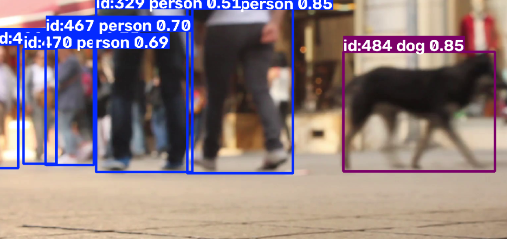

# AI Object Detection and Tracking

## Project Overview
This project uses YOLO and Python to detect and track objects in images and videos.

## Features
- Detect objects in images.
- Track objects in videos.
- Display bounding boxes and object labels.
- Assign tracking IDs to detected objects.
- Save the processed tracking video.

## Technologies Used
- Python
- Ultralytics YOLO
- OpenCV

## Installation
Install the required packages:

```bash
pip install -r requirements.txt
```

## Run Object Detection

```bash
python detect.py
```

## Run Object Tracking

Place your permitted sample video in the project folder as `sample.mp4`, then run:

```bash
python track.py
```
## Object Tracking Results

This screenshot demonstrates object detection and tracking using YOLO. The bounding boxes show detected objects, confidence scores, and tracking IDs.



## Output
The object detection image and tracking video are generated by the application.

## Project Purpose
Developed as an AI project to demonstrate object detection and video tracking using a pretrained YOLO model.
